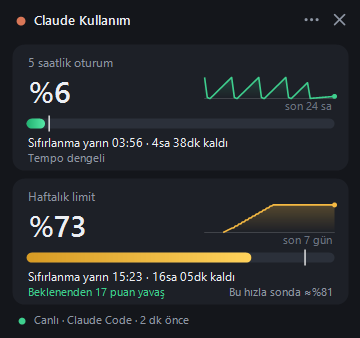

# Claude Usage Panel

A tiny always-on-top Windows panel that shows your Claude subscription limits live: the **5-hour session** and the **weekly limit**, with exact reset times, a pace indicator and a short history graph.

**No sign-in. No account linking. No network access.** About 22 MB of RAM and ~0 % CPU when idle (a 40 KB executable).



> Unofficial community project. Not affiliated with, endorsed by, or sponsored by Anthropic. "Claude" is a trademark of Anthropic.
> The user interface is currently in Turkish (all strings are in `src/Panel.cs`).

## How it works

Claude Code passes a JSON document to its configurable `statusLine` command after every response. For subscribers it contains an official `rate_limits` field (usage percentage and reset time for the 5-hour and 7-day windows).

1. `usage-feed.exe` is registered as the `statusLine` command. It reads that JSON from stdin and writes **only** the limits to `%LOCALAPPDATA%\ClaudeUsagePanel\` (`limits.txt`, `history.csv`). Project paths, conversation content and tokens are never stored.
2. `ClaudeUsagePanel.exe` reads those files and draws the panel. As a fallback it reads Claude Desktop's own `plan-usage-history.json` log (percentages only, no reset time).

Nothing is ever sent over the network, and no credentials are read or stored.

## Requirements

Windows 10/11. Building uses the C# compiler that ships with Windows (.NET Framework 4.8), so nothing needs to be downloaded or installed.

## Install

```powershell
.\build.ps1            # compile to .\bin
.\install.ps1          # copy to %LOCALAPPDATA%\ClaudeUsagePanel\bin + Start Menu shortcut
.\connect-claude.ps1   # add the statusLine entry to ~/.claude/settings.json (makes a backup first)
```

`connect-claude.ps1` adds a single `statusLine` entry. It refuses to overwrite an existing one, validates the JSON before and after, and keeps a timestamped backup. Undo with `.\connect-claude.ps1 -Remove`; uninstall with `.\install.ps1 -Uninstall`.

## Usage

Drag to move · double-click the header for compact mode · right-click or the ⋯ button for the menu · × hides to the tray · the tray icon shows the 5-hour percentage. The white tick on a bar marks where you would be if you used the limit evenly across the window. A notification is shown above 90 %.

Try it without any data: `ClaudeUsagePanel.exe --demo`.

## Limitations

- Values update whenever Claude Code receives a response. They are account-wide, but if you have not used Claude Code for a while the shown values are older (the panel shows their age).
- Per-model weekly limits are not exposed through `statusLine`, so they are not shown.
- `statusLine` support in Claude Code is what this relies on; if it changes, the feeder may need updating.

## License

MIT

---

# Claude Kullanım Paneli (Türkçe)

Claude abonelik limitlerini (5 saatlik oturum ve haftalık limit) kesin sıfırlanma zamanı, tempo göstergesi ve kısa geçmiş grafiğiyle canlı gösteren, her zaman üstte duran küçük Windows paneli.

**Giriş yok, hesap bağlama yok, ağ bağlantısı yok.** Boşta yaklaşık 22 MB bellek ve ~%0 CPU.

> Resmî olmayan topluluk projesidir; Anthropic ile bağlantılı değildir.

## Nasıl çalışır
Claude Code, her yanıttan sonra `statusLine` komutuna resmî `rate_limits` alanını (yüzde + sıfırlanma zamanı) içeren JSON verir. `usage-feed.exe` bunu alıp yalnızca limitleri `%LOCALAPPDATA%\ClaudeUsagePanel\` altına yazar; `ClaudeUsagePanel.exe` o dosyaları okuyup paneli çizer. Proje yolu, sohbet içeriği ve token saklanmaz.

## Kurulum
```powershell
.\build.ps1            # derle (Windows'un içindeki .NET Framework; indirme yok)
.\install.ps1          # kur + Başlat menüsü kısayolu
.\connect-claude.ps1   # ~/.claude/settings.json'a statusLine ekler (önce yedek alır)
```
Geri alma: `.\connect-claude.ps1 -Remove` ve `.\install.ps1 -Uninstall`.
